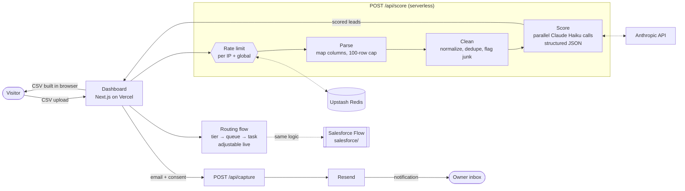

# Leadwise

**Upload a lead list. See who to call first.**

Leadwise takes a messy CSV of leads (inbound forms, event scans, list imports), cleans it, scores every row with Claude against a transparent ICP rubric, and routes each lead the way a Salesforce record-triggered Flow would.

Built by [Ariel Laish](https://www.linkedin.com/in/ariellaish) as a working demo of GTM engineering: data hygiene, AI lead scoring, routing logic and a deployed backend.

## Architecture



1. **Rate limit**: 3 uploads per IP per day and 150 overall, counted in Redis. Without Redis in production the API refuses to run.
2. **Parse and clean** (no AI): common header aliases, title-casing, "TLV" → Tel Aviv, "NYC" → New York, merge duplicates by email, flag test and no-reply rows.
3. **Score**: clean rows are split into chunks of 10 and scored in parallel by Claude Haiku against the rubric, returning schema-validated JSON. Junk rows never reach the model. The tier comes from the score in code, so the cut-offs stay deterministic.
4. **Route**: the dashboard runs the same logic as the Salesforce Flow in [`salesforce/`](salesforce/), and visitors can change its two variables.
5. **Download gate**: email and consent go to `/api/capture`, which emails the owner. The scored CSV is generated in the browser, and uploaded data is never stored.

| Piece | File |
|---|---|
| Scoring rubric (editable) | `src/config/rubric.ts` |
| Cleaning and dedupe | `src/lib/clean.ts` |
| Claude scoring | `src/lib/score.ts` |
| Routing flow | `src/lib/flow.ts` |
| Rate limiting | `src/lib/rateLimit.ts` |
| API routes | `src/app/api/score`, `src/app/api/capture` |
| Salesforce Flow, fields, queues | [`salesforce/`](salesforce/) |

## Stack

Next.js (App Router, TypeScript, Tailwind) on Vercel · Claude Haiku via the Anthropic SDK · Upstash Redis · Resend · Salesforce Flow metadata

**Live demo:** https://leadwise-beta.vercel.app

## Run locally

```bash
npm install
cp .env.example .env.local   # add keys; without ANTHROPIC_API_KEY a local rubric scorer is used
npm run dev
```

Click **Try sample data** to run the included fictional list (`public/sample-leads.csv`).

## Cost and safety

- Up to 10 small parallel Claude Haiku calls per upload, max 100 rows: well under one cent per run.
- 3 uploads per IP per day, 150 per day overall. Without Redis in production, scoring is refused rather than left unprotected.
- Uploaded CSVs are processed in memory and never stored or logged.
