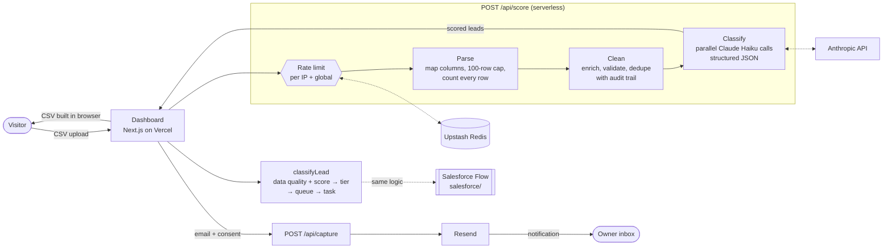

# Leadwise

**Upload a lead list. See who to call first.**

Leadwise takes a messy CSV of leads (inbound forms, event scans, list imports), cleans it, scores every row with Claude against a transparent ICP rubric, and routes each lead the way a Salesforce record-triggered Flow would.

Built by [Ariel Laish](https://www.linkedin.com/in/ariellaish) as a working demo of GTM engineering: data hygiene, AI lead scoring, routing logic and a deployed backend.

## Architecture



1. **Rate limit**: 3 uploads per IP per day and 150 overall, counted in Redis. Without Redis in production the API refuses to run. The owner can bypass it with `OWNER_KEY`.
2. **Parse**: common header aliases (including full names, phones, states), original row numbers kept. Files over 100 rows get a notice first; skipped and empty rows are counted and listed, never dropped silently.
3. **Clean** (no AI):
   - *Enrich*: segment from company size ("51-200 employees", "1K-5K", "Enterprise"), region from country, city, state or email domain. Anything we can't place is "Unavailable", not blank.
   - *Validate*: every issue per lead (malformed email, missing name or company, invalid phone, placeholder or suspicious names, conflicting location, unreadable size). Data quality is Valid, Needs review or Invalid, separate from lead quality.
   - *Dedupe*: exact (email, phone, name + company) and fuzzy (similar name, same company) matching. Conflicting pairs (e.g. same name, different emails) are flagged for review instead of merged. Every merge is recorded.
4. **Classify and score**: Claude labels seniority, industry fit, the strongest buying signal (with the quoted evidence) and explicit "not interested". Code adds the rubric points, so every score has a line-by-line breakdown. Strong signals (pricing or demo request, purchase intent, renewal, expansion) outweigh weak ones (a guide download).
5. **Tier and route** (`src/lib/flow.ts`, one function used by the dashboard, CSV and PDF): invalid data → Data Hygiene; explicit no interest → Do Not Contact; then Hot / Warm by score, strong signals at least Warm, everything else valid → Nurture. A low score never disqualifies. Every decision has a written reason.
6. **Download gate**: email and consent go to `/api/capture`, which emails the owner. The CSV and one-page PDF are generated in the browser from the same rows and summary as the dashboard; uploaded data is never stored.

| Piece | File |
|---|---|
| Scoring rubric (editable) | `src/config/rubric.ts` |
| Cleaning and dedupe | `src/lib/clean.ts` |
| Claude scoring | `src/lib/score.ts` |
| Tier and routing (single source of truth) | `src/lib/flow.ts` |
| Location enrichment | `src/lib/geo.ts` |
| Shared summary + CSV records | `src/lib/summary.ts` |
| PDF report | `src/lib/report.ts` |
| Regression tests | `tests/` (`npm test`) |
| Rate limiting | `src/lib/rateLimit.ts` |
| API routes | `src/app/api/score`, `src/app/api/capture` |
| Salesforce Flow, fields, queues | [`salesforce/`](salesforce/) |

## Stack

Next.js (App Router, TypeScript, Tailwind) on Vercel · Claude Haiku via the Anthropic SDK · Upstash Redis · Resend · Salesforce Flow metadata

**Live demo:** https://leadwise-beta.vercel.app

## Run locally

```bash
npm install
cp .env.example .env.local   # add keys; without ANTHROPIC_API_KEY a local rubric scorer is used
npm run dev
```

Click **Run the sample list** to try the included fictional list (`public/sample-leads.csv`). Run `npm test` for the regression suite.

## Cost and safety

- Up to 10 small parallel Claude Haiku calls per upload, max 100 rows: well under one cent per run.
- 3 uploads per IP per day, 150 per day overall. Without Redis in production, scoring is refused rather than left unprotected.
- Uploaded CSVs are processed in memory and never stored or logged.
