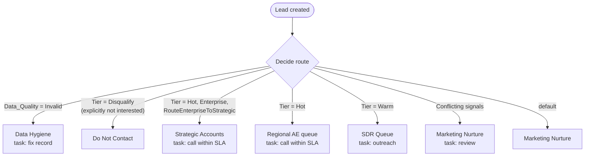

# Salesforce metadata

The routing logic the Leadwise dashboard simulates, as deployable Salesforce metadata (SFDX source format).

| File | What it is |
|---|---|
| `flows/Leadwise_Lead_Routing.flow-meta.xml` | Record-triggered Flow on Lead (after save, on create) |
| `objects/Lead/fields/Lead_Score__c` | Number(3,0), the 0-100 score |
| `objects/Lead/fields/Lead_Tier__c` | Picklist: Hot, Warm, Nurture, Disqualify |
| `objects/Lead/fields/Data_Quality__c` | Picklist: Valid, Needs review, Invalid (separate from tier) |
| `objects/Lead/fields/Conflicting_Signals__c` | Checkbox: strong buying signal plus explicit "not interested" |
| `objects/Lead/fields/Region__c` | Text, the normalized region |
| `objects/Lead/fields/Segment__c` | Text: SMB, Mid-Market, Enterprise |
| `queues/*` | 10 Lead queues the Flow routes into |

## Who decides what

Leadwise decides **data quality** and **tier** (it holds the score, thresholds and buying-signal logic, all tunable in the dashboard). The Flow routes on those fields, in the same order the dashboard does:



A low score alone never disqualifies a lead. `HotTaskDueDays` (1), `WarmTaskDueDays` (3) and `RouteEnterpriseToStrategic` (false) are Flow constants, matching the dashboard controls.

## Deploy to a dev org

```bash
cd salesforce
sf org login web --alias leadwise-dev
sf project deploy start --target-org leadwise-dev
```

The Flow deploys as **Draft**. Activate it in Setup → Flows after adding members to the queues.
